<p align="center">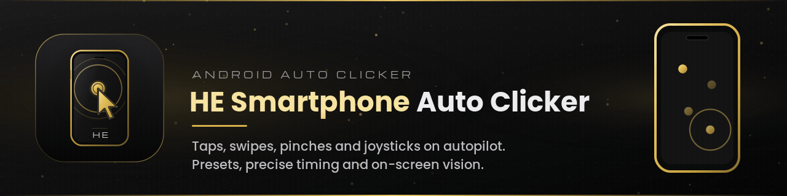</p>

<p align="center">
  <a href="https://github.com/hugoegry"></a>
  &nbsp;
  <a href="mailto:hugo.egry@epitech.eu"></a>
  &nbsp;
  <a href="https://github.com/hugoegry?tab=stars"></a>
</p>

<h2 align="center">An Android auto clicker that replays <strong>taps, swipes, pinches and joystick moves</strong> over any app, with blocks, presets, precise timing and on-screen vision.</h2>
<br>

<div align="center">

<p align="center">
  
  
  
  
  
  
</p>

[Features](#features) • [Screenshots](#screenshots) • [How it works](#how-it-works) • [Install](#install-the-apk) • [Usage](#usage-guide) • [Build](#build-from-source) • [Privacy](#permissions-and-privacy) • [Team](#contributors) • [Demo](#demo) • [Contribute](#contribute) • [License](#license)

</div>
<br>

---

## About The Project

<p align="center">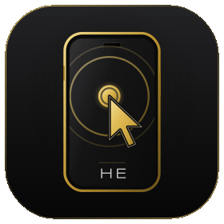</p>

**HE Smartphone Auto Clicker** (`com.he.he_smartphone_auto_clicker`) is a personal Android project. You place gestures on top of any app with a floating gold-and-black bar, set their timings, group them into blocks, then press play: an **Accessibility Service** replays everything with real gestures (`dispatchGesture`), in order or at random, until you pause.

On Android 11 and newer, the app can also **watch the screen**: an image or text detector spots something (a button, an icon, a banner) and triggers a block of actions after an optional timer. Setups are saved as **presets** and can be exported to a `.hepreset.json` file to share or back up.

<p align="center">
  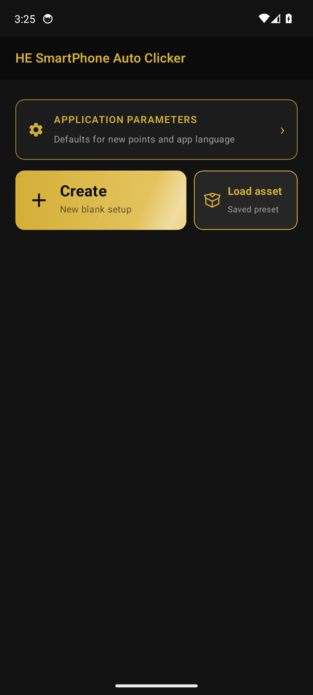
  &nbsp;&nbsp;
  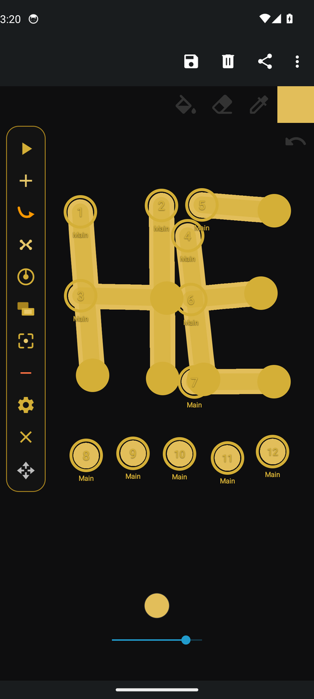
</p>

---

## Features

**Actions**

- **Click** and **double click** (a checkbox in the click editor), with press duration and time before the next action
- **Swipe** between two draggable points, with swipe duration and an optional hold at the end
- **Pinch**: zoom in or zoom out with two fingers, set in the pinch editor
- **Multi-touch** (two simultaneous presses) is handled by the gesture engine and the preset format; it has no button in the bar yet
- **Joystick**: a virtual stick disk with radius, angle sector and three modes (random direction, fixed direction, sweep angles)
- Up to **40 actions** per setup, each one editable by tapping its point (timings, block, position in the sequence)

**Blocks (groups)**

- Up to **12 blocks**, each with its own color-coded points
- Run modes: **Sequence**, **Random** (shuffled every cycle) or **On demand** (runs only when you tap Run)
- Per-block start delay, show / hide its points, choose which block new points go into
- Optional "pause every block" during an action or during its timer

**Run control**

- Floating bar that stays on top of any app, can be moved and collapsed to a compact play / close / move bar
- Global **start delay** (countdown before the first action)
- **On demand blocks** panel to fire a block manually while the main sequence runs

**Presets**

- Save, update, load, duplicate and delete (up to **40 presets**)
- **Import / export** as `.hepreset.json` through the Android file picker; image detectors are embedded in the file
- Example: [`examples/HE_Signature.hepreset.json`](examples/HE_Signature.hepreset.json), the preset recorded in the demo

**Vision (Android 11+)**

- **Image detectors**: draw a box around something on screen, add extra views of it, choose the search zone (around the capture, whole screen, or a custom zone) and the match threshold, then test it live
- **Text detectors**: on-device OCR with Google ML Kit, one phrase per line, tolerant to accents and small OCR errors
- When a detector fires: optional timer, then run an **on demand block**; the rest of the clicker can keep running, pause during the action, or pause during timer + action; optional re-trigger interval
- Optional **Gemini API key** (yours, free tier) to double-check detections on a downscaled screenshot. Leave it empty to stay 100 % on-device

**App**

- Default press / delay / swipe durations for new points
- **English and French** UI, plug-and-play language packs (`assets/lang/*.json`)

---

## Screenshots

<div align="center">
<table>
  <tr>
    <td align="center">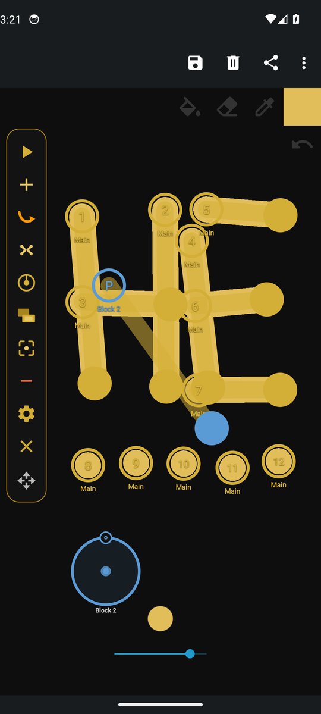<br><sub>Actions: swipes, taps, pinch (P) and joystick</sub></td>
    <td align="center">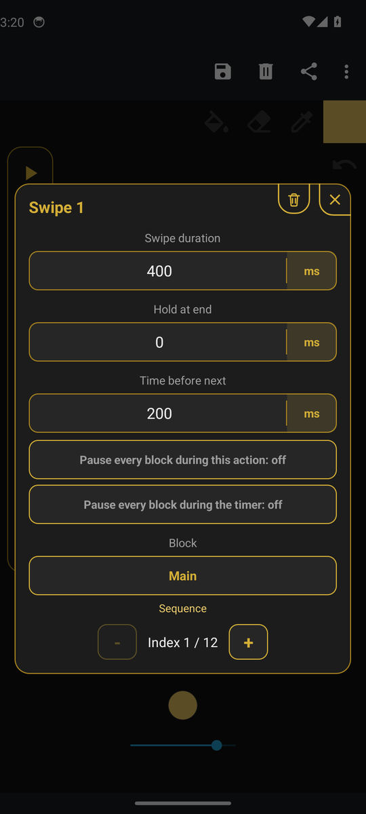<br><sub>Action editor (timings, block, index)</sub></td>
    <td align="center">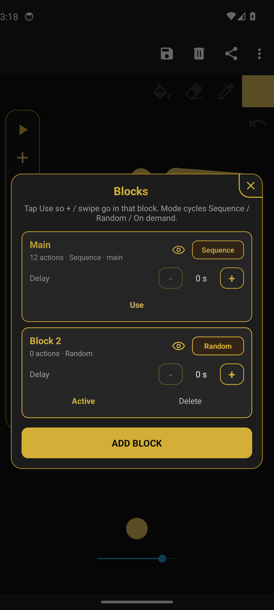<br><sub>Blocks: Sequence / Random / On demand</sub></td>
  </tr>
  <tr>
    <td align="center">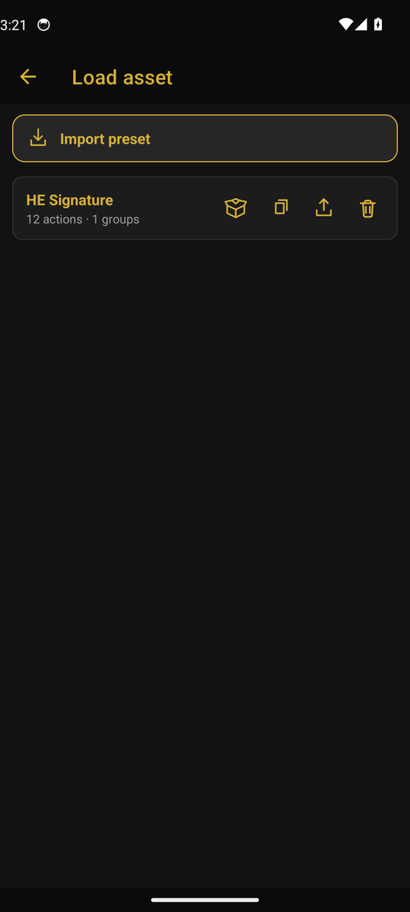<br><sub>Presets: load, duplicate, export, delete</sub></td>
    <td align="center">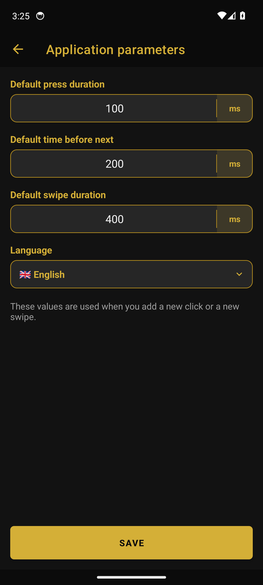<br><sub>Application parameters and language</sub></td>
    <td align="center">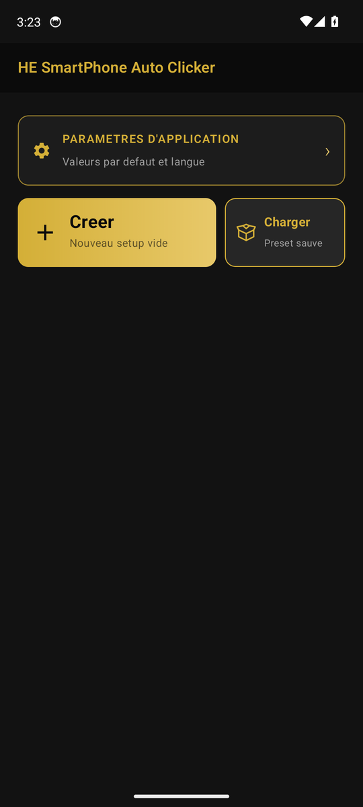<br><sub>French UI</sub></td>
  </tr>
  <tr>
    <td align="center">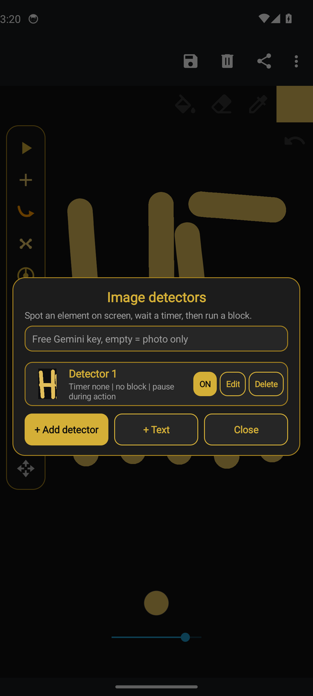<br><sub>Vision: image and text detectors</sub></td>
    <td align="center">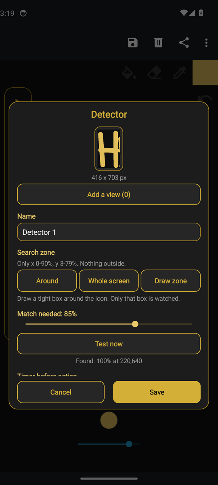<br><sub>Detector editor, live test: found 100 %</sub></td>
    <td align="center"><br><sub>Floating bar over another app</sub></td>
  </tr>
</table>
</div>

> All screenshots and the demo come from the real app running on an Android 14 emulator, with [Fossify Paint](https://f-droid.org/packages/org.fossify.paint/) (open source, F-Droid) as the background app so every tap and swipe leaves a visible gold mark.

---

## How it works

```
  MainActivity (Compose hub)          PresetsActivity / TimingSettingsActivity
            │  Create / Load                         │
            ▼                                        ▼
      OverlayStarter ── checks ──►  "Display over other apps"  +  Accessibility Service ON
            │
            ▼
  ClickerAccessibilityService ─────────────────────────────────────────────┐
   ├─ OverlayController   floating bar, draggable points, swipe lines,     │
   │                      joystick disks, dialogs (TYPE_ACCESSIBILITY_OVERLAY)
   ├─ run loop            blocks in Sequence / Random, delays, cycles,     │
   │                      dispatchGesture(GestureDescription) for every action
   └─ VisionWatcher       ScreenGrabber (takeScreenshot, API 30+)          │
                            ├─ TemplateMatcher  ZNCC, coarse-to-fine, multi-scale
                            ├─ TextFinder       ML Kit OCR on a cropped zone
                            └─ VisionAsk        optional Gemini yes/no check
                          → timer → run an On demand block ────────────────┘

  ClickerStore (SharedPreferences + JSON)   presets, blocks, actions, detectors
  DetectorFiles (app-private files)         detector template PNGs
```

1. **Accessibility Service** (`canPerformGestures`, `canTakeScreenshot`): the only way for a regular app to inject touches into other apps without root. Every action becomes a `GestureDescription` (one or two strokes, with durations), so the target app receives real touch input.
2. **Overlay**: the bar and the points are drawn as accessibility overlay windows above every app. While a run is active the points become non-touchable so the generated gestures go through to the app underneath. Tapping the move button collapses the bar and hides the points.
3. **Vision**: the service captures the screen with `AccessibilityService.takeScreenshot()` (no MediaProjection prompt). On Android 14+ it tries to capture only the app window, so the clicker's own points are not in the picture. Image detectors use zero-mean normalized cross-correlation (insensitive to brightness) on a reduced image first, then refine at full resolution. Apps that set `FLAG_SECURE` (for example PS Remote Play) return a black capture, and the app reports it.

---

## Install the APK

> The APK is published in **[Releases](../../releases)**, not in the repository.

1. On your phone, open the latest release and download `HE-Smartphone-Auto-Clicker-<version>.apk`.
2. Open the file. Android asks to allow installs from this source: **Settings → Apps → Special app access → Install unknown apps →** your browser or file manager **→ Allow**.
3. Install, then open **HE SmartPhone Auto Clicker**.
4. Tap **Create**. The app sends you to the two permissions it needs:
   1. **Display over other apps**: enable it for HE SmartPhone Auto Clicker, then go back.
   2. **Accessibility**: **Settings → Accessibility → Downloaded apps (or Installed services) → HE SmartPhone Auto Clicker → On**, and confirm.  
      On Android 13+, if the switch is greyed out ("Restricted setting"), open **Settings → Apps → HE SmartPhone Auto Clicker → ⋮ → Allow restricted settings**, then try again.
5. Come back to the app: the floating bar appears on the left. You are ready.

Requirements: Android 8.0+ (API 26). Vision features need Android 11+ (API 30).

<details>
<summary>Developer shortcut (adb)</summary>

```bash
adb install HE-Smartphone-Auto-Clicker-<version>.apk
P=com.he.he_smartphone_auto_clicker
adb shell appops set $P SYSTEM_ALERT_WINDOW allow
adb shell settings put secure enabled_accessibility_services $P/$P.service.ClickerAccessibilityService
adb shell settings put secure accessibility_enabled 1
```
</details>

---

## Usage guide

1. **Create a setup**: on the home screen tap **Create**. The app goes to the background and the bar appears over whatever app you open next.
2. **Add actions** from the bar:

   | Bar button | Action |
   |---|---|
   |  Play | Play / pause |
   |  Add | Add a click |
   |  Swipe | Add a swipe (two points joined by a line) |
   |  Pinch | Add a pinch |
   |  Joystick | Add a joystick |
   |  Blocks | Blocks panel |
   |  Vision | Vision (image / text detectors) |
   |  Remove | Remove the selected action |
   |  Preset panel | Preset panel (load, on demand blocks, start delay, save / update) |
   |  Close | Close the session |
   |  Move | Drag to move the bar, tap to collapse it |

3. **Place them**: drag each point (or both ends of a swipe) where you want it. Tap a point to edit its timings, block and order.
4. **Organise** with **Blocks**: create blocks, set each one to Sequence, Random or On demand, hide the points you do not need to see.
5. **Run**: tap the move button to collapse the bar (points hidden), then **▶**. Tap again to pause.
6. **Save**: gear → type a name → **Save as preset**. Later: home → **Load asset**, or gear → **Load preset**. From the preset list you can duplicate, export to a file, import, or delete.
7. **Vision (optional)**: Vision → **+ Add detector** → draw a box around the element → set zone, threshold, timer and the on demand block to run → **Test now** → **Save**. Use **+ Text** for a text detector.
8. **Defaults and language**: home → **Application parameters** (default press 100 ms, delay 200 ms, swipe 400 ms; English / Français).

---

## Build from source

| Tool | Version (from the Gradle files) |
|---|---|
| JDK | 17 (`sourceCompatibility` / `jvmTarget` 17) |
| Gradle wrapper | 8.11.1 |
| Android Gradle Plugin | 8.7.3 |
| Kotlin | 2.0.21 (+ Compose compiler plugin) |
| compileSdk / targetSdk | 35 |
| minSdk | 26 |

```bash
git clone https://github.com/hugoegry/HE-Smartphone-Auto-Clicker.git
cd HE-Smartphone-Auto-Clicker

# point Gradle at your Android SDK (or open the project in Android Studio)
echo "sdk.dir=$HOME/Android/Sdk" > local.properties

./gradlew assembleDebug          # app/build/outputs/apk/debug/app-debug.apk
./gradlew assembleRelease        # app/build/outputs/apk/release/app-release.apk
./gradlew testDebugUnitTest      # TemplateMatcher + TextQuery unit tests
```

On Windows use `gradlew.bat` and `sdk.dir=C\:\\Users\\<you>\\AppData\\Local\\Android\\Sdk`.

> The release build type is currently signed with the **debug** key (`signingConfig = signingConfigs.getByName("debug")`). Before publishing a Release, create your own keystore and a `release` signing config (keep the keystore and passwords out of git).

---

## Permissions and privacy

| Permission | Why |
|---|---|
| `BIND_ACCESSIBILITY_SERVICE` (the service) | Inject gestures into other apps, read the active window, take screenshots for detectors |
| `SYSTEM_ALERT_WINDOW` | Display the floating bar and points over other apps |
| `INTERNET` | Only used by the optional Gemini check in Vision |

- No account, no analytics, no ads. Presets, settings and detector images stay in the app's private storage.
- Screenshots are taken **only while image or text detectors are enabled**, and processed on the device (template matching and ML Kit OCR run locally).
- If you enter a **Gemini API key**, the app sends a downscaled JPEG of the screen (max 768 px wide) to `generativelanguage.googleapis.com` to confirm detections. The key is stored in the app's private preferences. Leave the field empty to keep everything offline.
- Use it responsibly: many online games and services forbid automated input in their terms of use.

---

## Languages

| Code | Language | File |
|---|---|---|
| `en` | English (default and fallback) | `app/src/main/assets/lang/en.json` |
| `fr` | Français | `app/src/main/assets/lang/fr.json` |

To add a language, copy `en.json`, change `code`, `name`, `flag`, translate the `strings`, and drop it in `assets/lang/`. Missing keys fall back to English, then to `res/values/strings.xml`.

---

## Tech stack

| Layer | Tech |
|---|---|
| Language | Kotlin 2.0.21, JVM 17 |
| Hub UI | Jetpack Compose (BOM 2024.10.01), Material 3 |
| Other screens and overlay | Android Views, ViewBinding, Material Components 1.12, RecyclerView |
| Automation | `AccessibilityService`, `GestureDescription` / `dispatchGesture` |
| Screen capture | `AccessibilityService.takeScreenshot` (API 30+) |
| Image matching | Pure Kotlin ZNCC template matcher (unit tested on the JVM) |
| OCR | Google ML Kit Text Recognition 16.0.1 (on-device, Latin) |
| Optional AI check | Gemini REST API (user key) |
| Storage | SharedPreferences + JSON, app-private PNG files |
| Build | Gradle 8.11.1, AGP 8.7.3, JUnit 4 |

---

## Project structure

```
├── app/
│   ├── build.gradle.kts
│   └── src/
│       ├── main/
│       │   ├── AndroidManifest.xml
│       │   ├── assets/lang/              en.json, fr.json (plug-and-play languages)
│       │   ├── java/com/he/he_smartphone_auto_clicker/
│       │   │   ├── MainActivity.kt       Compose hub (Create / Load / Parameters)
│       │   │   ├── OverlayStarter.kt     permission checks, opens the bar
│       │   │   ├── PresetsActivity.kt    list, import / export, duplicate, delete
│       │   │   ├── TimingSettingsActivity.kt   defaults + language
│       │   │   ├── data/                 ClickerStore (presets, blocks, actions), DetectorFiles
│       │   │   ├── model/                ActionKind, ClickerAction, ActionGroup, Detector, ClickerPreset
│       │   │   ├── service/              ClickerAccessibilityService, OverlayController,
│       │   │   │                         JoyPadView, VisionUi, VisionWatcher
│       │   │   ├── vision/               ScreenGrabber, TemplateMatcher, TextFinder, TextQuery, VisionAsk
│       │   │   ├── i18n/                 runtime language packs
│       │   │   └── ui/, util/            theme, time input, joystick math
│       │   └── res/                      layouts, drawables, xml/accessibility_service_config.xml
│       └── test/                         TemplateMatcherTest, TextQueryTest (+ images)
├── examples/HE_Signature.hepreset.json   preset used in the demo
├── gradle/wrapper/                       Gradle 8.11.1 wrapper
├── build.gradle.kts · settings.gradle.kts · gradle.properties
└── gradlew · gradlew.bat
```

---

## Contributors

<div align="center">
<table>
  <tr><th>Avatar</th><th>Name</th><th>Role</th><th>GitHub</th></tr>
  <tr>
    <td align="center"></td>
    <td><b>Hugo Egry</b></td>
    <td>Author</td>
    <td><a href="https://github.com/hugoegry">@hugoegry</a></td>
  </tr>
</table>
</div>

---

## Demo

A real session on an Android emulator: create a setup, place 7 swipes and 5 taps over Fossify Paint (shown at 4x), press play and let the clicker write **HE** in gold, then save it as the **HE Signature** preset.

<p align="center">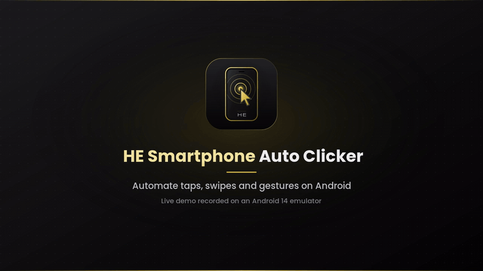</p>

<p align="center"><a href="assets/demo/demo.mp4">Watch the full video (MP4)</a></p>

---

## Contribute

This project grows with the community. If you like it, a **star** on the repo helps a lot, and **pull requests** are welcome to keep improving it.

- Star the repo: [HE-Smartphone-Auto-Clicker](https://github.com/hugoegry/HE-Smartphone-Auto-Clicker)
- Open an issue for a bug or an idea
- Fork, create a branch, then open a **pull request** with a short description of the change

Ideas that help: bug fixes, clearer UI, new languages, better vision detectors, docs, and small quality-of-life upgrades. Keep PRs focused and easy to review.

Thanks to everyone who stars, reports issues or contributes code.

---

## License

Distributed under the [MIT License](LICENSE). Copyright (c) 2026 Hugo Egry.

### Disclaimer of liability

This app is provided **as is**, for personal and educational use. You use it **at your own risk**.

The author and contributors are **not responsible** for any damage, data loss, account ban, device issue, legal claim, or other consequence linked to the use or misuse of this software. You alone must respect the law and the terms of service of any app, game or service you automate. Automated input is often forbidden by those terms.

Accessibility, overlay and screen capture can interact with other apps on your device. Enable them only if you accept those risks.

Full legal text: [LICENSE](LICENSE) (MIT + Disclaimer of Liability).
If you do not agree, do not use the software.